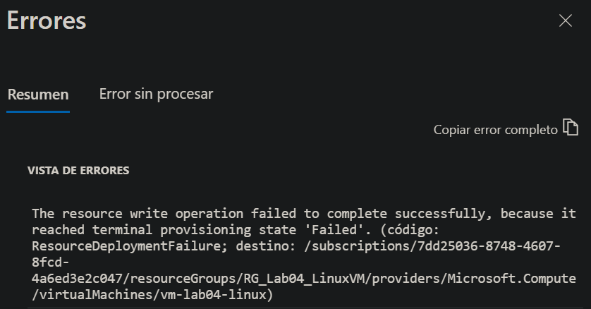
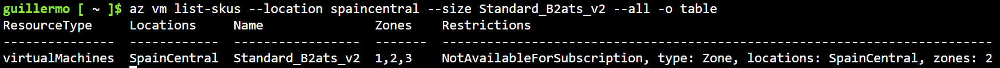
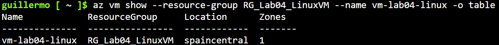
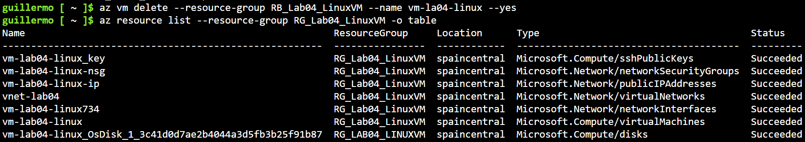
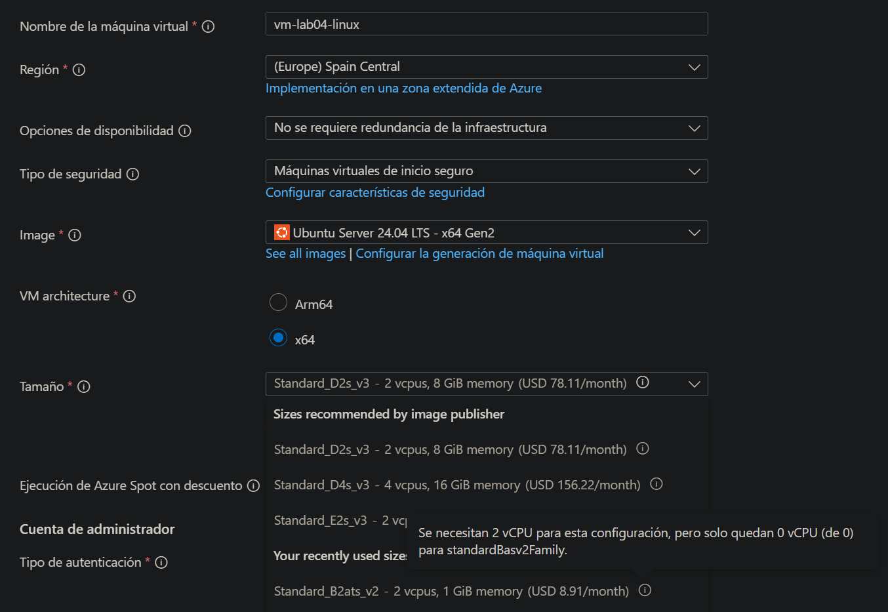
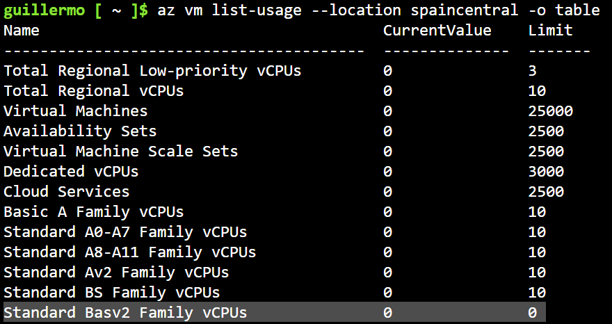

# Laboratorio 04
En este laboratorio quiero empezar a trabajar con infraestructura dentro de Azure creando alguna maquina virtual.

## Objetivos
1. Creacion de un Virtual Machine
2. Configuracion de una red virtual
3. Acceso mediante SSh
4. Administracion de VM mediante Azure CLI
5. Instalacion de un servicio web

## Conceptos
Como en los labpratorios anteriores, quiero poner en esta secion los terminos que vamos a utilizar durante el laboratorio, para en caso de ser necesario consulta la informacion.<br>
1. **Virtua Machine** = Dispositivo virtualizado
2. **Image (Imagen)** = Indica u sistema operativo
3. **VM Sieze** = Recursos asignados

## Arquitectura
```
                Azure
                  |
              Suscripcion
                  |
            RG_Lab04_LinuxVM
                  |
    ┌─────────────┴────────────────┐
    |                              |
    VM                      Virtual Network
    |                              |
Ubuntu Linux                     Subnet
    |                              |
Apache/Nginx             Network Security Group
                                   |
                          SSH :22  |
                         HTTP :80  | 
                                   |
                                Public IP
                                   |
                                Internet

```
<br>

**IMPORTANTE:** Como este laboratorio puede crear costes, para evitarlo voy a crear maquinas virtuales de pequenio tamanio, no agregar discos innecesarios, no usar servicios como Bastion y eliminar todo lo creado al terminar.<br>

## Configuracion
Para el entorno de este laboratorio crearemos el Resource Group `RG_Lab04_LinuxVM` con region en `spaincentral` y las etiquetas: `Project : Azure_labs` y `Lab : 04-LinuxVM`.

## Procedimiento
### 1.- Crear una VM
Para crear la maquina virtual, hay que entrar en **Virtual Machines -> Create -> Azure Virtual machine**. Para la creacion selecciono la suscripcion (azure_labs), el grupo de recursos (RG_Lab04_LinuxVM) y la region (Spain Central). Para esta maquina virtual voy a dejar las configuraciones predeterminadas y el nombre de la maquina es: **vm-lab04-linux**.<br>

Ahora voy a pasar a la configuracion de las caracteristicas de la maquina virtual. Lo primero de todo es seleccionar la **Image** del SO, que sera **Ubuntu Server 24.04 LTS**. Despues selecciono el tamanio en **Size** (CPU, RAM, Red y rendimiento), en esta parte hay que tener especial cuidado porque es donde pueden aumentar los costes, en mi caso he buscado ``Standard_B2ats_v2`` (2vcpus y 1 GiB memory) ya que si entra incluida en la suscripcion gratuita. Para la arquitectura selecciono ``x64``. <br>

Tras lo anterior, voy a configurar el usuario para conectarse a Linux. Lo primero es seleccioar ``SSH public key`` sin contrasenia. Despues, idicare el nombre del usuario, **azreuser**, y en ``SSH public key source`` selecciono ``Generate new key pair`` ya que es la primera vez que utilizo SSH en Azure.<br>

```
NOTA: cuando selecciono esta opcion lo que sucede es que Azure genera una clave publica que se descarga en la maquina virtual, y la clave privada se descarga en mi equipo. Por motivos obvios de seguridad, este archivo no se subira en GitHub.
```
<br>

Lo siguiente a configurar son los puertos que estan habilitados. Para ello desahibilito todos menos el puerto 22 para acceder por **SSH**.<br>

Tras la cinfiguracion de los puertos, toca configurar el disco **(Disk)**. En esta seccion seleciono ``Standard SSD`` en el tipo de disco, dejo los 30 GB de tamanio, y el resto de la configuracion predeterminada.<br>

El siguiente paso de la configuracion es la red, donde unicamente pondre el nombre a la red, **vnet-lab04**. Las demas configuraciones las dejo predetreminadas, ya que la IP publica esta habilitada, en Network Security Group (NSG) solo esta habilitado el trafico por el puerto 22.<br>

Todas las demas opciones de configuracion las dejo predeterminadas. En futuros laboratorios ya entrare mas afondo con dichas configuraciones, como para **Azure Monitor**. Y tras esto creamos la maquina virtual, pero antes, al revisar comprobamos el precio para evitar gastos.<br>

```
NOTA: aunque en el precio ponga un gasto por hora, las primeras 750 horas al mes de las VM son gratuitas. Este se distribuye a todas las VM creadas en la suscripcion. Las horas gratuitas se renuevan cada mes
```
<br>

## Errores
### Implementacion de la VM
Al intentar crear e implementar la maquina virtual, hubo un error:<br>

<br>

Al buscar este error, encontre informacion donde especificaba que el espacio de la zona seleccionada estaba ocupado y no habia suficiente almacenamiento para mi VM.<br>

Lo primero que hago es comprobar mediante Azure CLI las zonas que admite el SKU (Stock Keeping Unit), el identificador de una variante de servicio o recurso, mediante el siguiente comando:<br>
```bash
az vm list-skus \
    --location spaincentral \
    --size Standard_B2ats_v2 \
    --all \
    --o table
```
<br>


<br>

Lo que puedo observar es que la **Zona 2** esta restringida para los recursos de mi suscripcion, pero no indica nada de la **Zona 1** donde he puesto la VM. Con esto confirmo que lo mas probable sea problema de la capacidad de la zona, y para intentar solucionar ese problema voy a cambiar las **Availability options** de Zone 1 por **No infraestructure redundacy required**.<br>

Lo primero que voy a comprobar es si el fallo ha sido antes de crear la VM o después, para ello voy a compobar si existe la VM:<br>
```bash
az vm show \
    --resource-group RG_Lab04_LinuxVM \
    --name vm-lab04-linux \
    -o table
```
<br>


<br>

Al existir la VM es mas sencillo eliminarla y crear de otra. Para elminarla uso:<br>
```bash
az vm delete \
    --resource-group RG_Lab04_LinuxVM \
    --name vm-lab04-linux \
    --yes
```
<br>

Si no se consigue borrar con eso (mi caso), se puede usar para borrar directamente el recurso:<br>
```bash
az resource delete \
    --resource-group RG_Lab04_LinuxVM \
    --resource-type Microsoft.Compute/VirtualMachines \
    --name vm-lab04-linux
```
<br>

Y despues compruebo los recursos que han quedado en **R:Lab04_LinuxVM**:<br>
```bash
az resource list \
    --resource-group RG_Lab04_LinuxVM \
    --yes
```
<br>


<br>

De los recursos que aun quedan vamos a utilizar algunos:<br>

| Recurso | Funcion | Reutilizar |
|---------|---------|------------|
| `vm-lab04-linux_key` | Es la clave publica SSH | Si |
| `vm-lab04-linux-nsg` | Es el **Network Security Group** de la VM | Si |
| `vm-lab04-linux-ip` | Es la IP de la VM | Si |
| `vnet-lab04` | Es la red virtual | Si |
| `vm-lab04-linux734` | Es la NIC de la VM, es mucho mejor crear una | No |
| `vm-lab04-linux` | Es la VM, aparece porque esta en proceso de ser eliminada | No |
| `vm-lab04-linux-OsDisk...` | Es el disco de la VM que ha fallado, es mucho mejor crear una nuevo | No |

<br>

Procedo a borrar los recursos que no vaya a usar uno a uno:<br>
```bash
az network nic delete \
    --resource-group RG_Lab04_LinuxVM \
    --name vm-lab04-linux734
```
<br>

```bash
az disk delete \
    --resource-group RG_Lab04_LinuxVM \
    --name vm-lab04-linux_OsDisk_1_3c41d0d7ae2b4044a3d5fb3b25f91b87 \
    --yes
```
<br>

Ahora voy a crear la VM, pero me aparece un nuevo problema... Llegado a este punto empiezo a pensar que Microsoft no quiere que practique lo que he aprendido en sus certificaciones. Este nuevo problema es que la suscripcion que tengo no me permite crear en esta region una VM con la configuracion inicial que tenia. En el siguiente punto de errores expliacre que es lo que pasa mas detalladamente.<br>

### Disponibilidad de la Region para los recursos
A la hora de crear la nueva VM he encontrado el problema de insuficiencia de vCPU. Este error me indica que necesito 2 vCPUs para la configuracion de **Ubuntu Server 24.04 LTS** con el tamanio `Standard_B2ats_V2` pero que solo me quedan 0 vCPU dispinible de la familia `standardBasv2Family`.<br>

<br>

Ante la duda de que aun estuviese consumiendo vCPUs la anterior VM decido comprobar la cuota que tengo exactamente:<br>
```bash
az vm list-usage \
    --location spaincentral \
    -o table
```
<br>


<br>

En el resultado de la consulta puedo observar que no tengo disponibles ningun vCPU en esta region para la familia `Standard Basv2 Family`. Ante esta situacion tengo dos opciones para solucinarlo: la primera consiste en cambiar el Tamanio por `Standard BS Family` que tengo disponibles 10 vCPUs para usar; la segunda opcion es comprobar distintas regiones para ver si tengo vCPUs disponibles. La opcion que voy a escoger es la segunda, me intersa de cara a futuro poder usar esa familia y que no me quiero rendir tan facilmente.<br>

Tras un rato buscando si las regiones cercanas tenian disponibilidad y no encontrar resultado, he decidido decantarme por la primera opcion